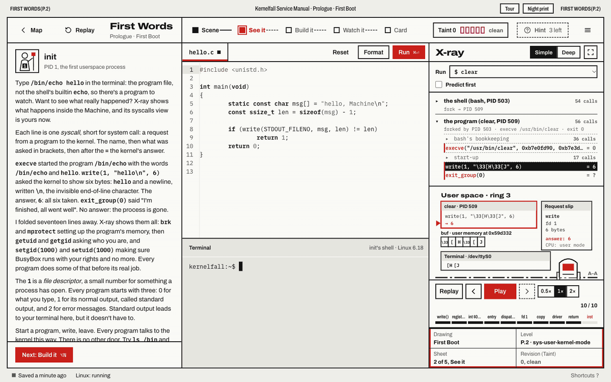
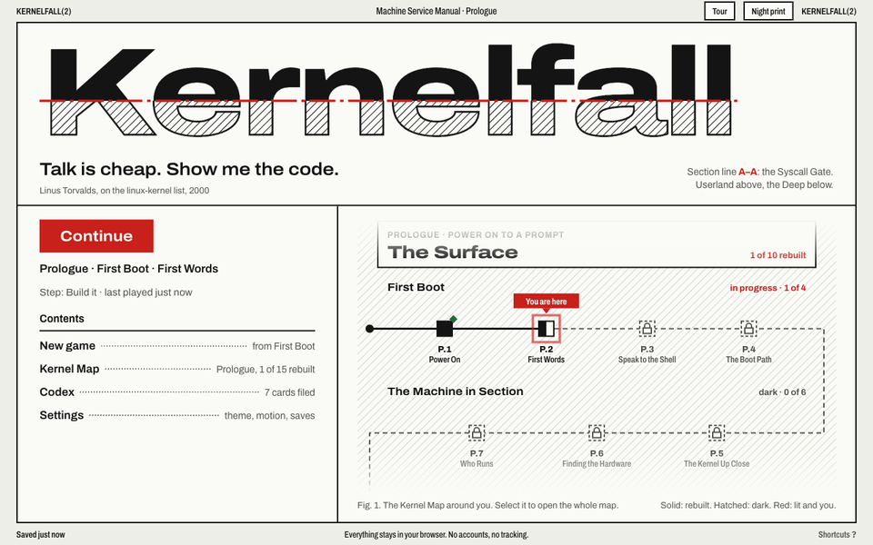
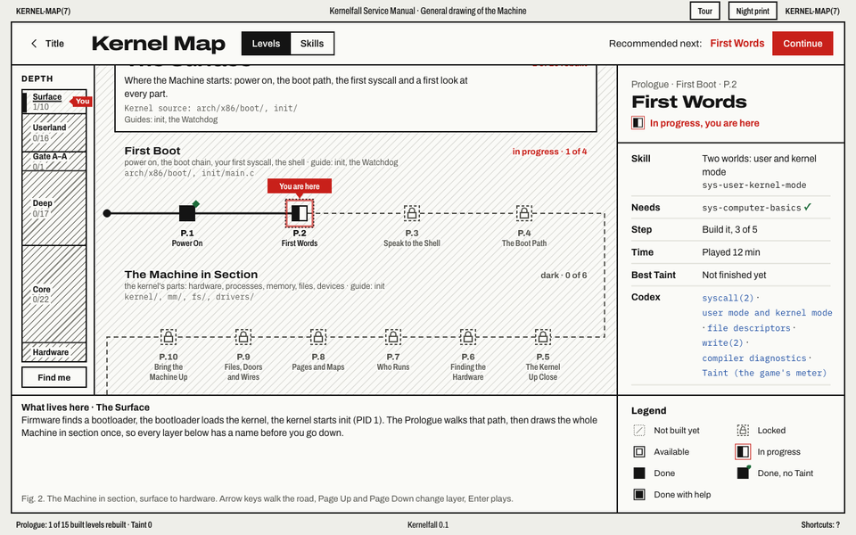
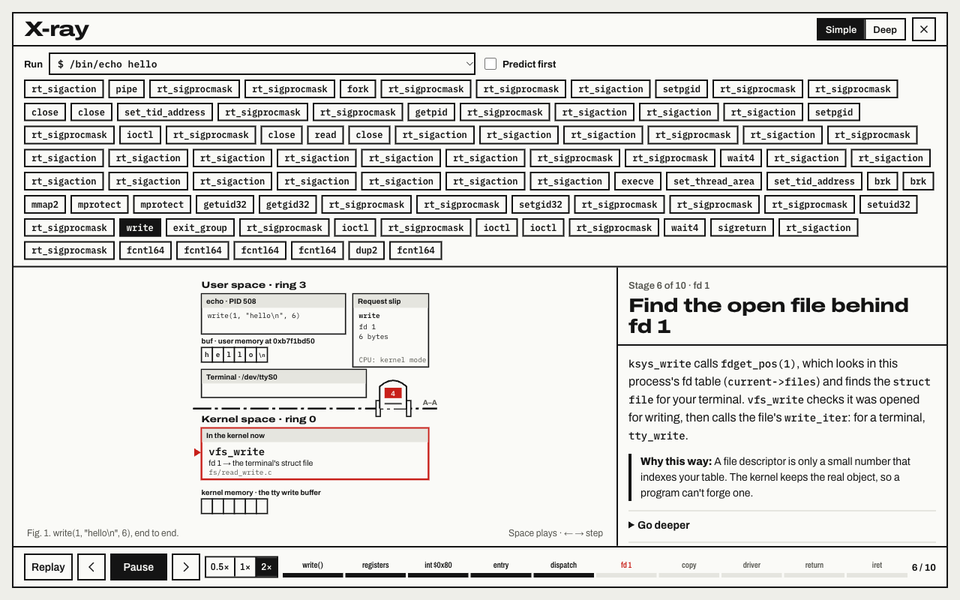

# Kernelfall

[](https://kernelfall.shadid.dev)
[](https://github.com/amrshadid/kernelfall/actions/workflows/ci.yml)
[](https://github.com/amrshadid/kernelfall/releases)
[](LICENSE)
[](docs/ARCHITECTURE.md#the-machine)

**Play it in your browser: [kernelfall.shadid.dev](https://kernelfall.shadid.dev)** (a
desktop browser; the first visit downloads the Linux machine, about 11 MB).

> Talk is cheap. Show me the code.
>
> — Linus Torvalds, on the linux-kernel list, 2000



Kernelfall is a free, open-source game that teaches Linux kernel development in
your browser, starting from zero. You start as a tiny process in a machine that
crashed, learn the shell, write your own C, and go down toward the kernel, while
**X-ray mode** shows what the kernel does for every command you run.

The Machine is real: a Linux 6.18 kernel (Alpine Linux, 32-bit x86) running in an
emulated PC ([v86](https://github.com/copy/v86)) inside your browser. Your C is
built by gcc inside it, and X-ray reads the kernel's own trace. There is nothing to
install and no server.

Kernelfall is in development. The Prologue, the Surface Survey and the first Act I
levels are being built now ([roadmap](docs/ROADMAP.md)).

| The title page                                                                          | The Kernel Map                                                                            | X-ray                                                                                         |
| --------------------------------------------------------------------------------------- | ----------------------------------------------------------------------------------------- | --------------------------------------------------------------------------------------------- |
|  |  |  |

## What you'll learn

- **Prologue and Surface Survey:** what a computer, an operating system and a
  kernel are; syscalls, boot, hardware, processes, memory; the shell, files,
  permissions and text tools.
- **Act I, Userland:** systems C, processes, file descriptors, pipes, signals,
  sockets, syscalls. You build a shell and a chat server.
- **Act II, The Deep:** modules, character devices, `ioctl`, procfs/sysfs, kernel
  memory, locking, timers and interrupts. You build a driver.
- **Act III, The Core:** how the kernel runs the whole machine, from power-on to a
  packet.

## Run it

Requirements: Node.js 22 and pnpm 10+.

```sh
pnpm install
pnpm vm:image   # builds the Linux image (downloads pinned Alpine packages, ~117 MB)
pnpm dev
```

## Docs

- [The game](docs/GAME.md): story, systems, levels and interface
- [Architecture](docs/ARCHITECTURE.md): packages, the Machine, the event stream, storage
- [Levels](docs/LEVELS.md): how levels are built, and the whole journey
- [Curriculum](docs/CURRICULUM.md): the skills the game teaches
- [Brand](docs/BRAND.md): the "Section 2" visual identity
- [Contributing](CONTRIBUTING.md): setup, workflow and code rules
- [Roadmap](docs/ROADMAP.md): where the game stands and what to work on next
- [Changelog](CHANGELOG.md): what has changed

## License

The game is [MIT](LICENSE). Kernel C in the levels (modules and drivers) is
GPL-2.0, as each file's `SPDX-License-Identifier` says, like the Linux kernel itself.
